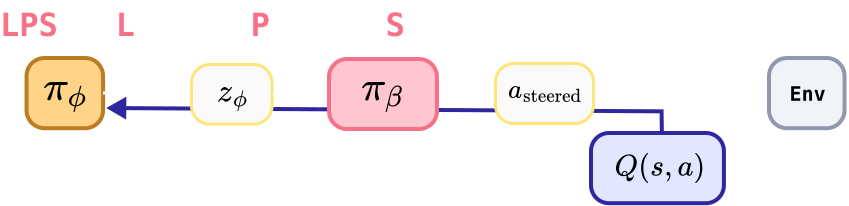

<div align="center">

# Latent Policy Steering

</div>

[](https://arxiv.org/abs/2603.05296)
[](https://huggingface.co/collections/jellyho/droid-dataset)
[](https://jellyho.github.io/LPS/)


## 📰 News
- [2026/04/28] [LPS](https://arxiv.org/abs/2603.05296) accepted to RSS 2026 🎉
- [2026/03/06] [LPS](https://arxiv.org/abs/2603.05296) is now on arXiv.
- [2026/03/05] We release the code of LPS.

<hr />

<p align="center">
  <a href="https://jellyho.github.io/LPS/">
    
  </a>
</p>


## Overview
**Latent Policy Steering (LPS)** is a robust offline reinforcement learning framework for robotics that resolves the brittle trade-off between return maximization and behavioral constraints. Instead of relying on lossy proxy latent critics, LPS directly optimizes a latent-action-space actor by backpropagating original-action-space Q-gradients through a differentiable one-step MeanFlow policy. This architecture allows the original critic to guide end-to-end optimization without proxy networks, while the MeanFlow policy serves as a strong generative prior. As a result, LPS works out-of-the-box with minimal tuning, achieving state-of-the-art performance across OGBench and real-world robotic tasks.

## Contents

- [⚙️ Installation](#installation)
- [🟦 OGBench](#ogbench)
- [🦾 DROID](#droid)
- [🤗 LeRobot datasets](#lerobot-datasets)
- [🤖 Running on your own robot](#running-on-your-own-robot)
- [🔁 Online fine-tuning](#online-fine-tuning)
- [📁 Repository layout](#repository-layout)

## Installation

`setup_env.sh` installs one mode at a time. Every mode starts from the same training stack
(JAX 0.6 with CUDA 12, Flax, Optax), listed in `requirements.txt`.

| Mode | Command | Installs |
| --- | --- | --- |
| Training and inference | `sh setup_env.sh` | new conda env `lps` (Python 3.10) from `requirements.txt` |
| OGBench | `sh setup_env.sh ogbench` | the above, plus `requirements_ogbench.txt` (OGBench, MuJoCo, dm_control) |
| DROID robot host | `sh setup_env.sh droid` | `requirements_droid.txt` into the **active** env that already holds DROID |

A trailing argument names the environment, e.g. `sh setup_env.sh ogbench lps_og`. The DROID mode
first prints every installed package the install would change and stops if there are any; re-run
with `FORCE=1` to proceed anyway.

## OGBench

```bash
sh setup_env.sh ogbench
conda activate lps
```

`lps_ogbench.sh` trains for 1M steps and evaluates every 100k steps on
`<task_name>-singletask-task<task_num>-v0`:

```bash
sh lps_ogbench.sh <agent_name> <task_name> <task_num> <alpha> <seed> [extra main.py flags]

# LPS
sh lps_ogbench.sh lps cube-single-play 1 1.0 100
sh lps_ogbench.sh lps cube-double-play 1 1.0 100
sh lps_ogbench.sh lps scene-play 1 1.0 100
sh lps_ogbench.sh lps puzzle-3x3-play 1 1.0 100
sh lps_ogbench.sh lps puzzle-4x4-play 1 1.0 100

# QC-FQL
sh lps_ogbench.sh qcfql cube-single-play 1 30.0 100
sh lps_ogbench.sh qcfql cube-double-play 1 3.0 100
sh lps_ogbench.sh qcfql scene-play 1 1.0 100
sh lps_ogbench.sh qcfql puzzle-3x3-play 1 3.0 100
sh lps_ogbench.sh qcfql puzzle-4x4-play 1 10.0 100
```

`<agent_name>` is a file under `agents/`, and `<alpha>` sets `--agent.alpha`. Any other config
key can be appended as `--agent.<key>=<value>`; the keys and their defaults are in each agent's
`get_config()`. Checkpoints and `flags.json` go to `exp/<project>/<run_group>/<env_name>/sd<seed><timestamp>/`.
Runs log to Weights & Biases.

### DSRL

DSRL (`agents/dsrl.py`) steers a multi-step BC flow policy through its noise space with a
noise-space critic, and runs through the same script. `alpha` scales the latent actor's Q objective.

```bash
sh lps_ogbench.sh dsrl cube-double-play 1 1.0 100
```

The remaining agents are baselines and building blocks: `flow` and `meanflow` (behaviour
cloning), `qcfql`, `qcmfql` (QC-FQL with a MeanFlow policy) and `cfgrl`.

## DROID

The real-robot setup of the paper: a Franka arm with a wrist and an exterior camera.

### Install

Install DROID first. We have made some changes, so we recommend our forked repo:

```bash
git clone https://github.com/jellyho/droid.git
cd droid
git submodule sync
git submodule update --init --recursive
```

Follow the [DROID instruction](https://droid-dataset.github.io/droid/software-setup/host-installation.html#configuring-the-laptopworkstation) and make sure the server side is ready.

Then install LPS into the same environment:

```bash
conda activate <the environment DROID is in>
sh setup_env.sh droid
```

### Collect

```bash
python droid_teleop.py                    # --left_controller to use the left Oculus controller
```

Trajectories are written as HDF5 (`.h5`):

```text
droid_dataset_dir/
├── task_1/
│   ├── success/
│   │   ├── trajectory_0.h5
│   │   └── ...
│   └── failure/
│       └── ...
└── task_2/
    └── ...
```

### Train

```bash
sh lps_droid.sh <task_name> <droid_dataset_dir> <seed> [extra main.py flags]
sh lps_droid.sh task_2 ~/droid_dataset_dir 100
```

Only the `success/` trajectories are used unless `--droid_use_failure` is passed. State and action
are normalised per dimension onto `[-1, 1]` by their minimum and maximum, and the statistics are
written to `norm_stats.json` beside the checkpoints. Rewards are `-1` per step, `0` at the end of
a success and `-1/(1-γ)` at the end of a failure, with `γ` from `--discount` (`-100` at the default
`0.99`). With `--sparse` they are `0` per step, `+1` at the end of a success and `0` at the end of a
failure. A failure ends the episode in the datasets and online alike. See
`envs/robot_datasets.outcome_reward`.

### Evaluate

```bash
sh lps_eval.sh <checkpoint_dir> <checkpoint_step> droid [extra eval.py flags]
sh lps_eval.sh exp_droid/LPS_DROID/LPS:DROID:task_2/task_2/sd100<timestamp> 10000 droid
```

Press Enter to end a rollout. The VR trigger pauses it, and `--max_steps` caps its length.
`--video N` writes the first `N` rollouts out as mp4. Flags after the positional arguments of any
`lps_*.sh` script are passed on to `main.py` / `eval.py`.

## LeRobot datasets

LPS also trains on [LeRobot](https://github.com/huggingface/lerobot) datasets, which needs neither
the robot nor its software. Ours are on the [Hub](https://huggingface.co/collections/jellyho/droid-dataset).

### Install

```bash
sh setup_env.sh
conda activate lps
```

### Train

```bash
sh lps_lerobot.sh <dataset_name> <lerobot_dataset_dir> <seed> [extra main.py flags]
sh lps_lerobot.sh droid_pnp_carrot ~/lerobot_datasets 0
```

v3 layout, one directory per dataset:

```text
lerobot_dataset_dir/
└── dataset_name/
    ├── meta/           # info.json, episodes/**.parquet, tasks.parquet
    ├── data/           # chunk-***/file-***.parquet
    └── videos/         # observation.images.*/   (or frames inside data/)
```

Every camera in `meta/info.json` is used, stacked on the channel axis, and the state and action
widths come from the data. `--task` keeps a single instruction out of a multi-task dataset and
`--image_size` resizes the frames. Normalisation and rewards are as in DROID above.

DROID HDF5 trajectories, ours on the Hub or your own, convert to this layout with
`tools/droid_to_lerobot.py`. Writing a LeRobot dataset needs the `lerobot` package, so run it in an
environment that has it (reading the result does not):

```bash
python tools/droid_to_lerobot.py --repo_id jellyho/droid_pnp_carrot \
    --out_repo_id jellyho/droid_pnp_carrot_lerobot --root ~/lerobot_datasets/droid_pnp_carrot \
    --task "pick up the carrot and place it in the bowl"
```

`--src <dir>` reads a local directory holding `success/` and `failure/` instead of the Hub.

### Evaluate

The same command, with the adapter for whatever robot you run it on:

```bash
sh lps_eval.sh <checkpoint_dir> <checkpoint_step> <robot>
```

## Running on your own robot

`eval.py` takes `--robot` and everything specific to that robot lives in one file under `robots/`.
Copy `robots/template.py`, fill it in, and import it in `robots/__init__.py`:

```python
@register('your_robot')
class YourRobot(Adapter):
    def __init__(self, image_size=224, **kwargs):
        from your_sdk import Robot      # import here, so other adapters read without your SDK
        self.robot = Robot(camera_resolution=(image_size, image_size))

    def reset(self):
        self.robot.home()

    def close(self):
        self.robot.disconnect()

    def observe(self):                   # read the robot, in the dataset's language
        obs = self.robot.get_observation()
        state = np.concatenate([obs['arm_pose'], [obs['gripper']]])   # both arms, if bimanual
        views = [obs['cam_wrist'][..., :3], obs['cam_exterior'][..., :3]]
        return {'state': state, 'image': np.concatenate(views, axis=-1)}

    def act(self, action):               # send the policy's action as this robot's command
        self.robot.send(action)
```

The loop is `observe -> forward -> act`. `gate()` is optional; implement it if an operator should
be able to hold the robot mid-rollout, as DROID's VR trigger does.

The state order, the camera order and the action width have to match the dataset the policy was
trained on. They are recorded in `norm_stats.json`, and the first tick checks them, so a mismatch
raises before the robot moves.

## Online fine-tuning

Both paths continue from an offline policy and keep training on its dataset alongside the new
experience.

### On a robot, judged by an operator: `droid_online.py`

`droid_online.py` collects one rollout at a time and trains when it ends. The adapter needs two
more methods, when a rollout may begin and how it ended, and its control rate:

```python
    def wait_to_start(self, msg=None):   # block until the operator says go
        ...

    def outcome(self):                   # 'success', 'failure', or None while it runs
        ...

    control_hz = 15.0                    # how fast act() may be called
```

DROID reads `gate`, `wait_to_start` and `outcome` off the VR controller.

```bash
python droid_online.py --checkpoint_path <checkpoint_dir> --checkpoint_step <checkpoint_step> \
    --robot droid --env_name <task_name> --droid_dataset_dir <droid_dataset_dir>
```

Use `--lerobot_dataset_dir` instead of `--droid_dataset_dir` for a policy trained on a LeRobot
dataset. `--online_steps` sets the number of robot steps, `--utd` the gradient steps per robot
step, and the replay buffer and checkpoints go to `--save_dir`.

### In simulation: `main.py --online_steps`

On OGBench the environment reports success itself, so `main.py` fine-tunes online right after the
offline phase, with the offline dataset seeding the replay buffer. This is the offline-to-online
protocol of Q-Chunking (1M offline + 1M online steps):

```bash
sh lps_ogbench.sh lps cube-double-play 1 1.0 100 --online_steps 1000000
```

`--utd_ratio` sets the gradient steps per environment step.

## Repository layout

```text
main.py              offline training, then optional online fine-tuning in simulation
eval.py              evaluate a checkpoint on a robot adapter
droid_online.py      online fine-tuning on a robot, with an operator
droid_teleop.py      collect DROID demonstrations with the VR controller
lps_*.sh             launch scripts: OGBench, DROID, LeRobot, evaluation
setup_env.sh         environment setup; requirements*.txt per mode
agents/              lps, dsrl, and the flow / meanflow / qcfql / qcmfql / cfgrl baselines
utils/               networks, DiT, encoders, datasets and replay buffer, checkpointing, logging
envs/                OGBench and robot dataset loaders, normalisation
robots/              robot adapters (droid, template), online robot env, policy wrapper
tools/               DROID-to-LeRobot conversion, install preflight
```

## Acknowledgments
This codebase is built on top of [Reinforcement Learning with Action Chunking](https://github.com/ColinQiyangLi/qc). The DiT implementation follows [MeanFlowQL](https://github.com/HiccupRL/MeanFlowQL).

## Citation

If you find this work useful, please cite:

```bibtex
@inproceedings{im2026lps,
  author    = {Im, Hokyun and Kolobov, Andrey and Fu, Jianlong and Lee, Youngwoon},
  title     = {Latent Policy Steering through One-Step Flow Policies},
  booktitle = {Proceedings of Robotics: Science and Systems (RSS)},
  address   = {Sydney, Australia},
  month     = {July},
  year      = {2026}
}
```
